

# 📚 SCRIBD DOWNLOADER PRO 2026

### ⚡ Descarga libros de **Scribd** y presentaciones de **SlideShare** en **PDF y PPTX editables** — para **Windows 10 y 11**

**📥 [DESCARGAR ÚLTIMA VERSIÓN](https://github.com/Dev-LeviathanTM/Scribd-Downloader-Pro-2026/releases/latest)** · **🎬 [VER DEMO EN VIDEO](https://www.youtube.com/watch?v=2kepwLPUVzA)** · **💳 [COMPRAR LICENCIA](https://wa.me/51962829974)**

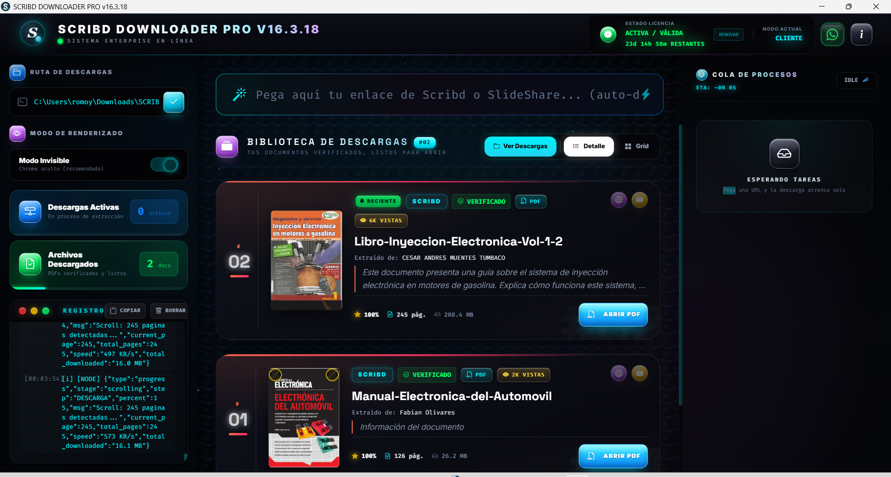

🖥️ Interfaz principal v16.3.20 — modo oscuro neon, 100% en español, biblioteca con portadas verificadas

---

## 📌 ¿Qué es SCRIBD DOWNLOADER PRO?

**SCRIBD DOWNLOADER PRO** es la aplicación de escritorio más completa para **descargar documentos de Scribd** y **convertir presentaciones de SlideShare a PDF y PowerPoint (PPTX) editable** en tu PC con **Windows 10 o Windows 11**. Sin límites, sin marcas de agua, con metadatos reales (portada, autor, páginas, valoración) y verificación página por página.

- 📕 **Scribd → PDF**: libros, manuales, tesis y documentos completos.
- 📊 **SlideShare → PDF + PPTX**: cada presentación se entrega en dos formatos en un solo pase.
- 🧠 **Motor inteligente**: detecta automáticamente si el enlace es de Scribd o SlideShare y elige la ruta de extracción óptima.
- ⚡ **Cola de procesos en paralelo**: pega varias URLs a la vez y descarga todo en segundo plano.
- 🔒 **Modo invisible**: Chrome trabaja oculto; tú ves solo la interfaz del programa.
- 🇪🇸 **100% en español**: interfaz, mensajes y soporte humano por WhatsApp.

**Índice:**
[✨ Novedidades](#-novedades-v16319) ·
[📥 Instalación](#-instalación--guía-para-principiantes) ·
[📖 Cómo usar](#-cómo-descargar-paso-a-paso-con-capturas) ·
[💰 Planes](#-planes-disponibles) ·
[🛡️ Seguridad](#️-seguridad-y-licencias) ·
[❓ FAQ](#-preguntas-frecuentes-faq) ·
[🖥️ Requisitos](#%EF%B8%8F-requisitos-del-sistema) ·
[🛠️ Tecnologías](#️-tecnologías)

---

## ✨ Novedades v16.3.20

- 🖥️ **Guardado en tu Escritorio** — por defecto los libros se guardan en `Escritorio \ SCRIBD DOWNLOADER PRO` (carpeta creada automáticamente). Si una ruta guardada pertenece al perfil de **otro usuario de Windows**, el programa la detecta y restaura la tuya en el acto.
- 📂 **Selector de carpeta nativo** — botón 📂 en *Carpeta de Guardado*: abre el explorador de Windows para elegir dónde guardar; también puedes escribir la ruta y pulsar ✔ (Enter también guarda).
- 🐛 **«Ver Descargas» reparado** — el botón ahora abre exactamente tu carpeta de guardado en el explorador (antes no respondía).
- 🖼️ **Vista Grid solo portadas** — la biblioteca en modo cuadrícula muestra únicamente las portadas en gran formato: toca cualquier portada para abrir la vista previa del documento.
- ✅ **Instalador inteligente Win10/11** — el instalador declara `MinVersion 10.0`: protege tu PC rechazando sistemas no compatibles e instala WebView2 en silencio si falta.
- 🎨 **Interfaz más limpia** — se eliminaron todas las animaciones de luz en bucle del encabezado, botones y modales.
- 💬 **Ícono de WhatsApp inteligente** — parpadea según el estado de tu licencia (activa / por vencer / sin licencia).
- 🔄 **RENOVAR lleva directo a los planes** — un clic en el botón del encabezado y ves precios y cantidades al instante.

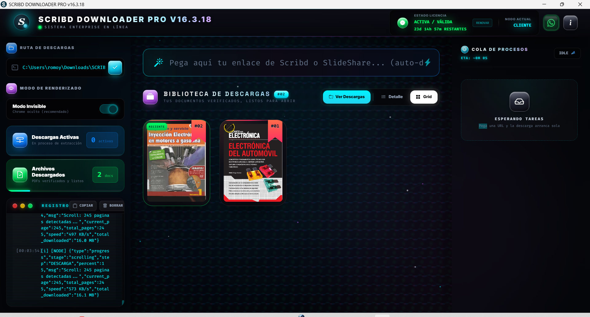

🖼️ Nueva vista Grid: solo las portadas de tus libros en gran tamaño

---

## 📥 Instalación — Guía para principiantes

Elige **una sola** de estas dos formas. No necesitas saber de programación.

### ✅ OPCIÓN A — Instalador (recomendada)

1. Entra a la página de **[Descargas oficiales](https://github.com/Dev-LeviathanTM/Scribd-Downloader-Pro-2026/releases/latest)**.
2. En la sección *Assets*, descarga el archivo **`Scribd_Downloader_Pro_Setup_v16.3.20_x64.exe`**.
3. Haz **doble clic** sobre el `.exe` descargado.
4. Si Windows muestra el aviso de SmartScreen: **Más información → Ejecutar de todos modos** (es normal en apps independientes).
5. Sigue el asistente: **Siguiente → Siguiente → Instalar → Finalizar**.
6. ¡Listo! El ícono **SCRIBD DOWNLOADER PRO** aparece en tu escritorio.

> 💡 El instalador requiere **Windows 10 / 11 (64 bits)** y instala automáticamente el motor **WebView2** si tu PC no lo tiene.

### 📁 OPCIÓN B — Portable (sin instalar nada)

Ideal para USB, PC prestada o sin permisos de administrador.

1. En la página de Releases, descarga **`SCRIBD_DOWNLOADER_PRO_v16.3.20_PORTABLE.zip`**.
2. Clic derecho → **Extraer todo… → Extraer**.
3. Entra a la carpeta extraída y ejecuta **`SCRIBD_DOWNLOADER_PRO_v16.3.20.exe`**.
4. *(Opcional)* Clic derecho → **Enviar a → Escritorio (crear acceso directo)**.

> 🤔 **¿Cuál elijo?** Si es tu PC personal → **Opción A**. Si es una PC temporal o pendrive → **Opción B**.

### 🔑 Después de instalar: licencia o DEMO gratis

1. Abre el programa: verás la pantalla **INGRESE LLAVE MAESTRA**.
2. **¿Tienes licencia?** Pega tu llave y pulsa **ACTIVAR LICENCIA**.
3. **¿Aún no la tienes?** Pulsa **PROBAR DEMO** para **3 descargas gratis** (protegido contra abusos con la huella de tu equipo) o compra desde [WhatsApp](https://wa.me/51962829974).

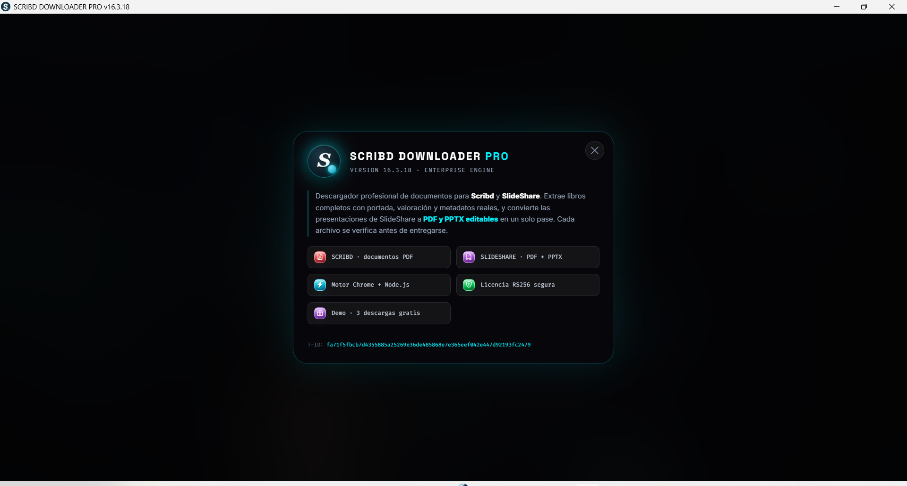

🔐 Acerca de: licencia RS256 verificada contra servidor, demo anti-abuso con huella de equipo

---

## 🎬 Míralo en acción

  
   🎬 Haz clic en la imagen para ver el programa en funcionamiento
   📼 <a href="PREVIEW%20DEL%20PROGRAMA.mp4">Ver video local del programa</a>

---

## 📖 Cómo descargar (paso a paso con capturas)

### Paso 1 — Copia la URL del documento

Abre el libro en **Scribd** o la presentación en **SlideShare** con tu navegador y **copia la URL de la barra de direcciones** (`Ctrl + C` o clic derecho → Copiar dirección del vínculo).

  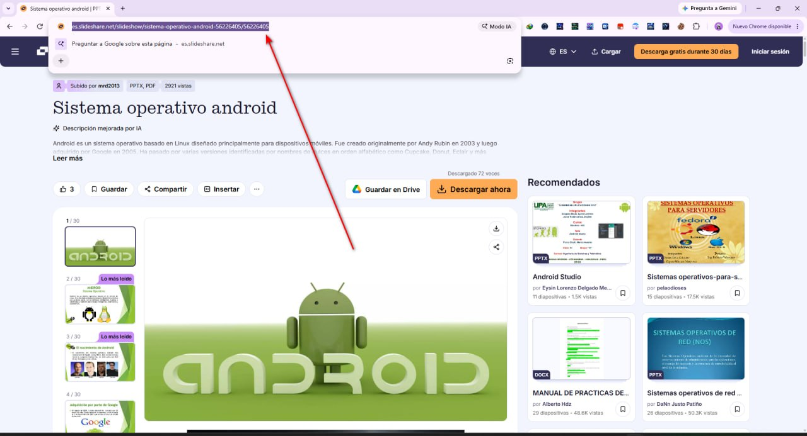
   🔎 Selecciona y copia la URL (slideshare.net/... o scribd.com/...)

  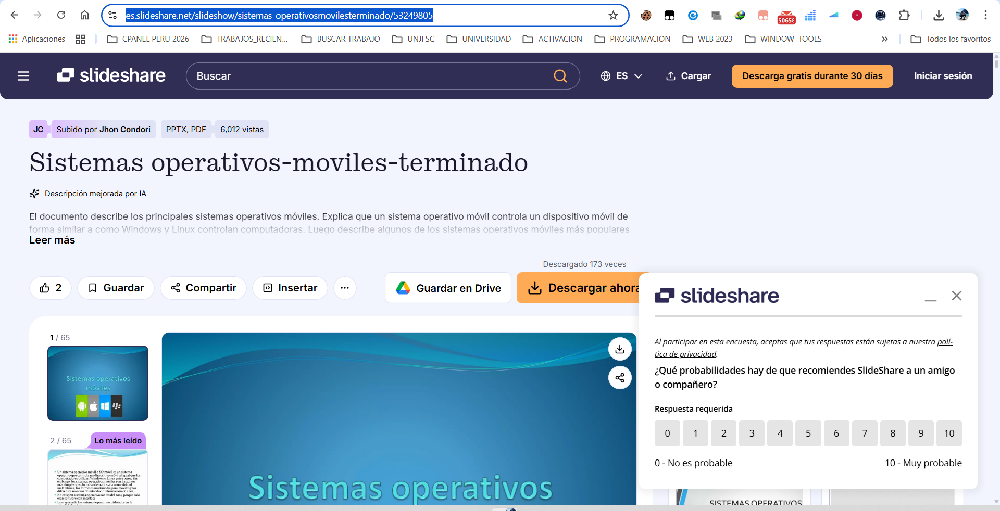
   ✅ Asegúrate de que la URL diga `es.slideshare.net` o `www.scribd.com`

> 💡 **Tip para encontrar libros**: busca en **Google Imágenes** el título del libro + `en scribd`, haz **clic derecho** sobre la portada y elige **«Copiar dirección del vínculo»**: obtienes el enlace directo del documento en Scribd sin siquiera abrirlo.

  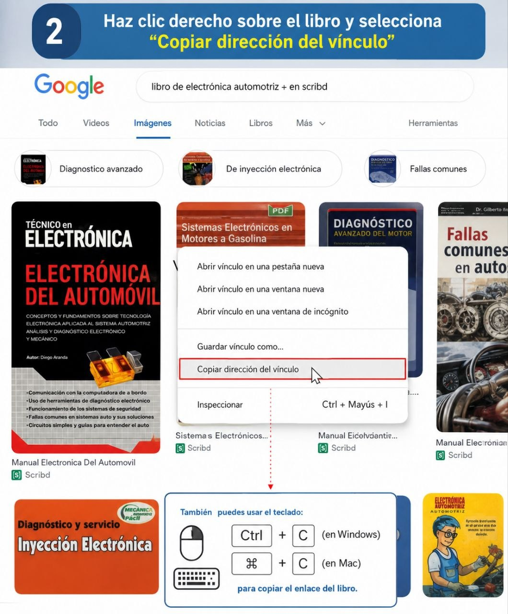
   🧠 Truco pro: clic derecho en Google Imágenes → «Copiar dirección del vínculo»

### Paso 2 — Pégala en el programa y pulsa EXTRAER

Vuelve a **SCRIBD DOWNLOADER PRO**, **pega la URL** en el campo superior (`Ctrl + V`) y pulsa **EXTRAER ⚡**. Puedes pegar varias URLs a la vez: la **cola inteligente** las procesa en paralelo con barra de progreso, ETA y registro interno en vivo.

  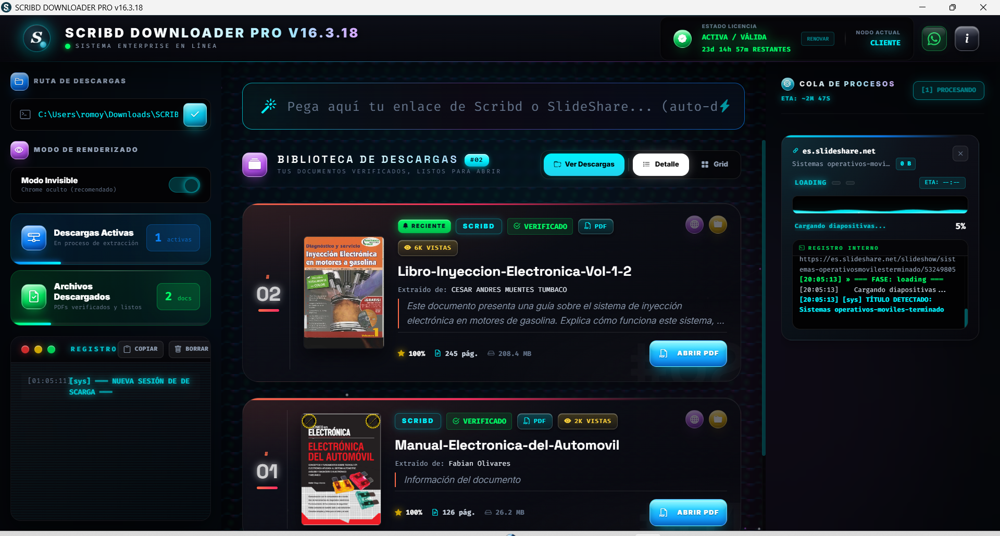
   ⚙️ Cola de procesos: descarga en curso con progreso, ETA y registro interno

### Paso 3 — Abre tu PDF o PPTX

Al terminar, la ficha del documento muestra portada, autor, páginas y peso. Pulsa **ABRIR PDF** (y **ABRIR PPTX** en presentaciones de SlideShare) y ¡listo! Por defecto los archivos quedan en **`Escritorio \ SCRIBD DOWNLOADER PRO`** (puedes cambiar la carpeta con el botón 📂 de *Carpeta de Guardado*).

  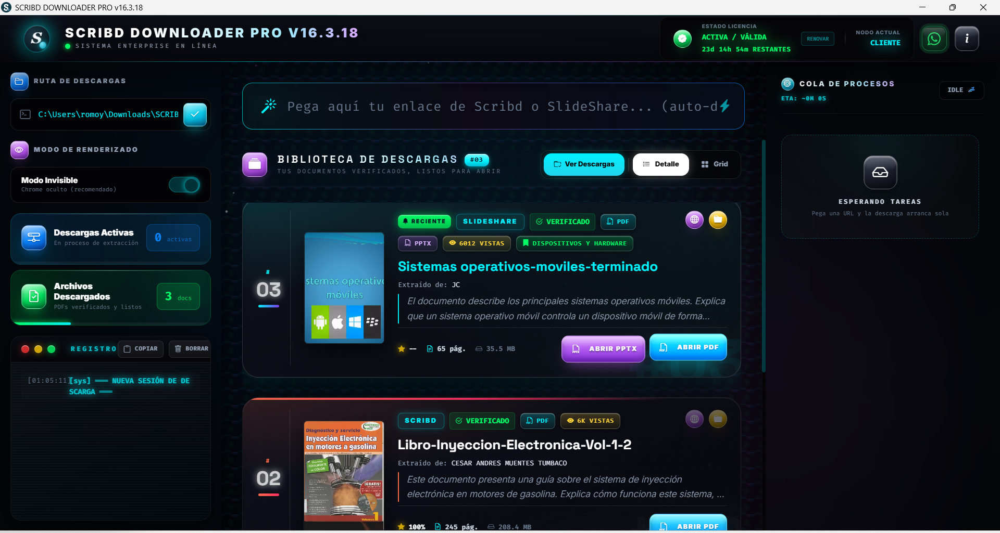
   📄 SlideShare entregado en PDF + PowerPoint editable con un solo clic

  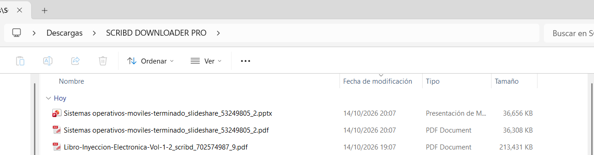
   📁 Tus libros verificados en <code>Escritorio \ SCRIBD DOWNLOADER PRO</code>, listos para abrir en Windows

🛡️ ¿SlideShare muestra una verificación anti-bot?

SlideShare protege su CDN. Si el programa detecta una pantalla de verificación, espera unos segundos y reintenta con el **Modo Visible** (menú de configuración). El motor convierte automáticamente las imágenes **WebP → JPEG** de alta calidad. Todo el proceso queda visible en el **REGISTRO** del programa.

---

## 💰 Planes disponibles

| Plan | Precio | Ideal para | Comprar |
| :--- | :--- | :--- | :--- |
| 🟢 **Cliente (1 mes)** | **S/10** | Uso personal, activación inmediata |  |
| 🔵 **Vitalicio** | **S/50** | Uso personal para siempre |  |
| 🟡 **Revendedor (3+)** | **S/4 c/u** | Negocio: precio mayorista y panel propio |  |

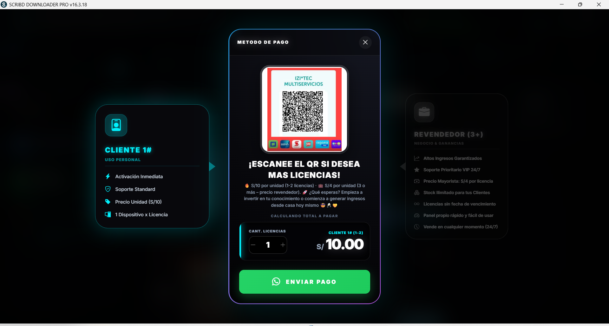
 🟢 Plan Cliente: activación inmediata, 1 dispositivo por licencia
  
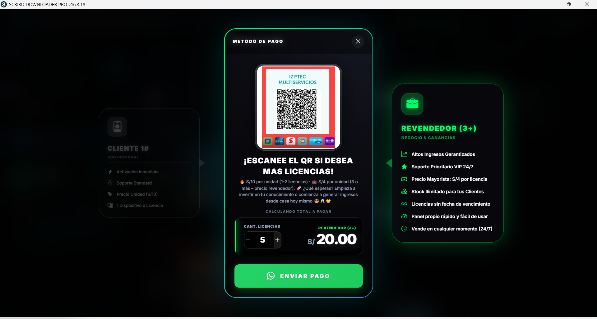
 🟡 Plan Revendedor: precio desde S/4, licencias sin vencimiento, panel y soporte VIP 24/7

**💳 Pagos**: escanea el QR de la app (Yape / Plin / BBVA / Interbank / Visa / Mastercard / Agora) o paga desde el extranjero con **Hotmart** o **PayPal**. ¿No eres de Perú? Escríbenos y te atendemos en minutos.

  <a href="https://wa.me/51962829974" style="display: inline-block; padding: 12px 25px; background-color: #25D366; color: white; text-decoration: none; border-radius: 30px; font-weight: bold; font-size: 1.2rem;">
    💬 ¡Escríbeme ahora por WhatsApp!
  </a>

### 🎁 ¿Qué incluye tu compra?

- ✅ **Instalación y activación** guiadas paso a paso en tu laptop.
- ✅ **Licencia RS256** firmada criptográficamente e imposible de forjar.
- ✅ **Actualizaciones gratis** mientras tu licencia esté activa.
- ✅ **Soporte técnico** real por WhatsApp (24/7).
- ✅ **Panel de control** para revendedores (plan 3+).

---

## ❓ Preguntas frecuentes (FAQ)

**¿Es gratis?**
Puedes probarlo con el **demo: 3 descargas gratis** por equipo. Los planes de pago desbloquean descargas ilimitadas.

**¿Funciona en Windows 10 y Windows 11?**
Sí — es su plataforma nativa: **Windows 10 y Windows 11 (64 bits)**. El instalador valida la versión del sistema e instala WebView2 automáticamente si falta.

**¿Necesito instalar algo más?**
No. El programa trae todo incluido (motor Chrome embebido). Solo necesitas conexión a internet.

**¿Qué diferencia hay entre Instalador y Portable?**
Ninguna en funciones. El **instalador** crea accesos directos y entradas de desinstalación; la **portable** se ejecuta desde cualquier carpeta sin instalar nada.

**¿Puedo usarlo en varias PC?**
El plan Cliente es para **1 equipo**; el plan **Revendedor** permite activar múltiples equipos con precio mayorista.

**¿Por qué Windows muestra un aviso al abrirlo?**
Es normal: los programas independientes sin certificado comercial activan el SmartScreen. Pulsa **Más información → Ejecutar de todos modos**.

**¿Puedo descargar cualquier documento?**
Úsalo con contenido del que seas propietario, con fines de estudio personal o con documentos disponibles para ti. El usuario es responsable del uso que dé al programa.

---

## 🛡️ Seguridad y licencias

- 🔐 **Licencias RS256**: tokens firmados con criptografía asimétrica y verificados contra el servidor oficial — imposibles de copiar o forjar.
- 🖐️ **Huella de equipo**: la demo se liga a tu PC (MAC, registro de Windows, hardware) para evitar el fraude.
- 🧬 **Código protegido**: el motor de extracción se empaqueta **ofuscado** (javascript-obfuscator: selfDefending + transformObjectKeys) y la app principal está compilada como **binario nativo Rust** — el código fuente nunca se distribuye.
- 🚪 **Firewall inteligente**: el instalador agrega la regla de red necesaria para el motor embebido y la desinstala al eliminar el programa.

---

## ⚙️ Requisitos del sistema

| Requisito | Mínimo |
| :--- | :--- |
| **Sistema operativo** | Windows 10 (x64) o Windows 11 (x64) |
| **Procesador** | Cualquier CPU x86-64 de doble núcleo o superior |
| **Memoria RAM** | 4 GB recomendados |
| **Internet** | Conexión estable (el motor usa Chrome en segundo plano) |
| **Extra** | Ninguno — WebView2 se instala automáticamente |

---

## 🛠️ Tecnologías

---

> ⚖️ **AVISO IMPORTANTE:** Este repositorio distribuye únicamente el **ejecutable compilado** y la documentación. El código fuente es **privado** para proteger el sistema de licencias. Úsalo únicamente con contenido del que seas propietario o con fines de estudio personal.

---

**🔑 Términos de búsqueda:** *descargar libros de Scribd* · *Scribd downloader* · *Scribd a PDF* · *descargar documentos de Scribd gratis* · *SlideShare a PDF* · *SlideShare a PowerPoint* · *convertir SlideShare a PPTX* · *descargar presentaciones de SlideShare* · *bajar libros en PDF* · *descargar Scribd Windows 10* · *descargar Scribd Windows 11* · *SCRIBD DOWNLOADER PRO 2026* · *lector de libros en PDF* · *herramienta español*

📜 Desarrollado con ❤️ para la comunidad hispanohablante · [Releases](https://github.com/Dev-LeviathanTM/Scribd-Downloader-Pro-2026/releases/latest) · [Issues](https://github.com/Dev-LeviathanTM/Scribd-Downloader-Pro-2026/issues)

